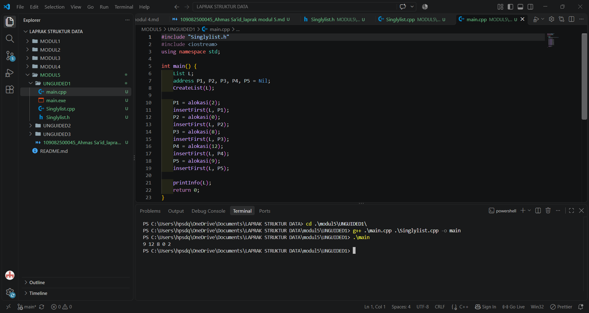
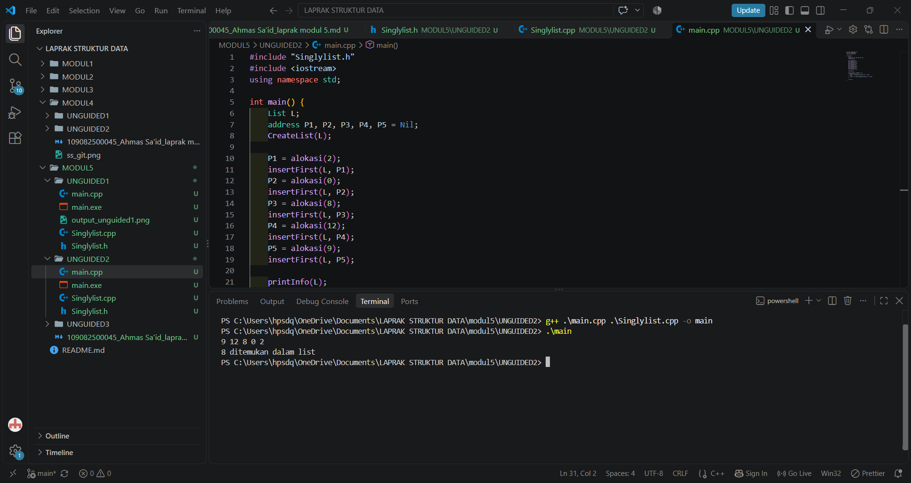
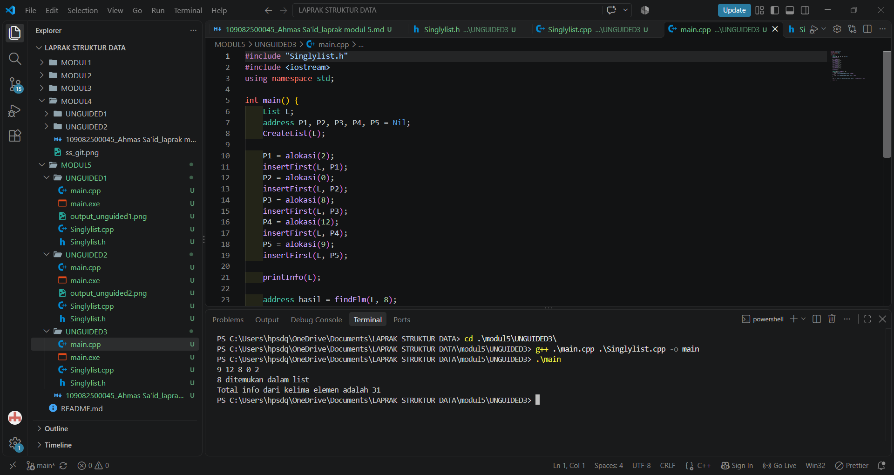

# <h1 align="center">Laporan Praktikum Modul 6 - Doubly Linked List (Bagian Pertama)</h1>
<p align="center">Ahmas Sa'id - 109082500045</p>

## Dasar Teori
Doubly Linked List merupakan struktur data linked list yang masing-masing elemennya memiliki dua buah pointer successor, yaitu next (menunjuk ke elemen sesudahnya) dan prev (menunjuk ke elemen sebelumnya). Berbeda dengan Singly Linked List yang hanya bisa ditelusuri satu arah, Doubly Linked List dapat ditelusuri dari depan ke belakang maupun dari belakang ke depan.
Komponen utama dalam Doubly Linked List:
First: Pointer yang menunjuk elemen pertama list.
Last: Pointer yang menunjuk elemen terakhir list.
Next: Pointer pada elemen yang menunjuk ke elemen di depannya.
Prev: Pointer pada elemen yang menunjuk ke elemen di belakangnya.
Operasi dasar pada Doubly Linked List meliputi CreateList, alokasi, dealokasi, printInfo, insertLast, serta operasi pencarian (searching) dan penghapusan (delete) seperti deleteFirst, deleteLast, dan deleteAfter. Pengecekan duplikasi data juga penting dilakukan sebelum menambahkan data baru ke dalam list agar tidak terjadi redundansi data.

## Unguided 

### 1. Pembuatan ADT Dasar dan Insert Data (Pengecekan Duplikasi)

```C++
File: Buku.h
#ifndef BUKU_H
#define BUKU_H

#include <iostream>
#include <string>
using namespace std;

#define Nil NULL

struct buku {
    string kodeBuku;
    string judul;
    int thnTerbit;
};

typedef buku infotype;
typedef struct ElmList *address;

struct ElmList {
    infotype info;
    address next;
    address prev;
};

struct List {
    address First;
    address Last;
};

void CreateList(List &L);
address alokasi(infotype x);
void dealokasi(address &P);
void printInfo(List L);
void insertLast(List &L, address P);
address findElm(List L, infotype x);

#endif

File: Buku.cpp
#include "Buku.h"
#include <iostream>
using namespace std;

void CreateList(List &L) {
    L.First = Nil;
    L.Last = Nil;
}

address alokasi(infotype x) {
    address P = new ElmList;
    P->info = x;
    P->next = Nil;
    P->prev = Nil;
    return P;
}

void dealokasi(address &P) {
    delete P;
    P = Nil;
}

void insertLast(List &L, address P) {
    if (L.First == Nil) {
        L.First = P;
        L.Last = P;
    } else {
        P->prev = L.Last;
        L.Last->next = P;
        L.Last = P;
    }
}

void printInfo(List L) {
    if (L.First == Nil) {
        cout << "List Kosong" << endl;
    } else {
        address P = L.Last;
        while (P != Nil) {
            cout << "kode buku : " << P->info.kodeBuku << endl;
            cout << "judul     : " << P->info.judul << endl;
            cout << "tahun     : " << P->info.thnTerbit << endl;
            cout << endl;
            P = P->prev;
        }
    }
}

address findElm(List L, infotype x) {
    address P = L.First;
    while (P != Nil) {
        if (P->info.kodeBuku == x.kodeBuku) {
            return P;
        }
        P = P->next;
    }
    return Nil;
}

File: main.cpp
#include "Buku.h"
#include <iostream>
using namespace std;

int main() {
    List L;
    CreateList(L);
    
    infotype dataBuku;
    cout << "masukkan kode buku: ";
    cin >> dataBuku.kodeBuku;
    
    while (dataBuku.kodeBuku != ".") {
        cout << "masukkan judul buku: ";
        cin >> dataBuku.judul;
        cout << "masukkan tahun terbit: ";
        cin >> dataBuku.thnTerbit;
        
        address cek = findElm(L, dataBuku);
        if (cek != Nil) {
            cout << "kode buku sudah terdaftar" << endl;
        } else {
            address P = alokasi(dataBuku);
            insertLast(L, P);
        }
        
        cout << "\nmasukkan kode buku: ";
        cin >> dataBuku.kodeBuku;
    }
    
    cout << "\nDATA LIST 1" << endl;
    printInfo(L);
    
    return 0;
}
```
### Output Unguided 1 :

##### Output 1


Program membuat list kosong dengan CreateList, kemudian meminta input secara berulang. Sebelum data dimasukkan ke dalam list menggunakan insertLast, fungsi findElm dipanggil untuk mengecek apakah kodeBuku sudah terdaftar. Jika duplikat (seperti input B001 kedua), program menolak dan menampilkan pesan. Fungsi printInfo sengaja ditelusuri mundur menggunakan pointer Last dan prev agar urutan output terbalik (B004, B003, B001), sesuai dengan ilustrasi pada soal.

### 2. Pencarian Elemen (Searching)

```C++
File: Buku.h
#ifndef BUKU_H
#define BUKU_H

#include <iostream>
#include <string>
using namespace std;

#define Nil NULL

struct buku {
    string kodeBuku;
    string judul;
    int thnTerbit;
};

typedef buku infotype;
typedef struct ElmList *address;

struct ElmList {
    infotype info;
    address next;
    address prev;
};

struct List {
    address First;
    address Last;
};

void CreateList(List &L);
address alokasi(infotype x);
void dealokasi(address &P);
void printInfo(List L);
void insertLast(List &L, address P);
address findElm(List L, infotype x);

#endif

File: Buku.cpp
#include "Buku.h"
#include <iostream>
using namespace std;

void CreateList(List &L) {
    L.First = Nil;
    L.Last = Nil;
}

address alokasi(infotype x) {
    address P = new ElmList;
    P->info = x;
    P->next = Nil;
    P->prev = Nil;
    return P;
}

void dealokasi(address &P) {
    delete P;
    P = Nil;
}

void insertLast(List &L, address P) {
    if (L.First == Nil) {
        L.First = P;
        L.Last = P;
    } else {
        P->prev = L.Last;
        L.Last->next = P;
        L.Last = P;
    }
}

void printInfo(List L) {
    if (L.First == Nil) {
        cout << "List Kosong" << endl;
    } else {
        address P = L.Last;
        while (P != Nil) {
            cout << "kode buku : " << P->info.kodeBuku << endl;
            cout << "judul     : " << P->info.judul << endl;
            cout << "tahun     : " << P->info.thnTerbit << endl;
            cout << endl;
            P = P->prev;
        }
    }
}

address findElm(List L, infotype x) {
    address P = L.First;
    while (P != Nil) {
        if (P->info.kodeBuku == x.kodeBuku) {
            return P;
        }
        P = P->next;
    }
    return Nil;
}

File: main.cpp
#include "Buku.h"
#include <iostream>
using namespace std;

int main() {
    List L;
    CreateList(L);
    
    infotype b1 = {"B001", "Algoritma", 2020};
    infotype b2 = {"B003", "Struktur_Data", 2018};
    infotype b3 = {"B004", "Jaringan_Komputer", 2022};
    
    insertLast(L, alokasi(b1));
    insertLast(L, alokasi(b2));
    insertLast(L, alokasi(b3));
    
    infotype cariBuku;
    cout << "Masukkan Kode Buku yang dicari : ";
    cin >> cariBuku.kodeBuku;
    
    address hasil = findElm(L, cariBuku);
    
    if (hasil != Nil) {
        cout << "\nKode Buku   : " << hasil->info.kodeBuku << endl;
        cout << "Judul       : " << hasil->info.judul << endl;
        cout << "Tahun Terbit: " << hasil->info.thnTerbit << endl;
    } else {
        cout << "\nBuku dengan kode " << cariBuku.kodeBuku << " tidak ditemukan." << endl;
    }
    
    return 0;
}
```
### Output Unguided 2 :

##### Output 1


Fungsi findElm menelusuri list dari elemen pertama hingga Nil. Setiap node dibandingkan nilai kodeBuku-nya dengan nilai yang dicari. Jika ditemukan node dengan kodeBuku == B001, fungsi mengembalikan alamat node tersebut. Program kemudian menampilkan detail informasi buku (Kode, Judul, Tahun) sesuai dengan data node yang ditemukan.

### 3. Penghapusan Elemen (Delete)

```C++
File: Buku.h
#ifndef BUKU_H
#define BUKU_H

#include <iostream>
#include <string>
using namespace std;

#define Nil NULL

struct buku {
    string kodeBuku;
    string judul;
    int thnTerbit;
};

typedef buku infotype;
typedef struct ElmList *address;

struct ElmList {
    infotype info;
    address next;
    address prev;
};

struct List {
    address First;
    address Last;
};

void CreateList(List &L);
address alokasi(infotype x);
void dealokasi(address &P);
void printInfo(List L);
void insertLast(List &L, address P);
address findElm(List L, infotype x);
void deleteFirst(List &L, address &P);
void deleteLast(List &L, address &P);
void deleteAfter(address Prec, address &P);

#endif

File: Buku.cpp
#include "Buku.h"
#include <iostream>
using namespace std;

void CreateList(List &L) {
    L.First = Nil;
    L.Last = Nil;
}

address alokasi(infotype x) {
    address P = new ElmList;
    P->info = x;
    P->next = Nil;
    P->prev = Nil;
    return P;
}

void dealokasi(address &P) {
    delete P;
    P = Nil;
}

void insertLast(List &L, address P) {
    if (L.First == Nil) {
        L.First = P;
        L.Last = P;
    } else {
        P->prev = L.Last;
        L.Last->next = P;
        L.Last = P;
    }
}

void printInfo(List L) {
    if (L.First == Nil) {
        cout << "List Kosong" << endl;
    } else {
        address P = L.Last;
        while (P != Nil) {
            cout << "kode buku : " << P->info.kodeBuku << endl;
            cout << "judul     : " << P->info.judul << endl;
            cout << "tahun     : " << P->info.thnTerbit << endl;
            cout << endl;
            P = P->prev;
        }
    }
}

address findElm(List L, infotype x) {
    address P = L.First;
    while (P != Nil) {
        if (P->info.kodeBuku == x.kodeBuku) {
            return P;
        }
        P = P->next;
    }
    return Nil;
}

void deleteFirst(List &L, address &P) {
    if (L.First == Nil) {
        cout << "List Kosong" << endl;
    } else if (L.First == L.Last) {
        P = L.First;
        L.First = Nil;
        L.Last = Nil;
        dealokasi(P);
    } else {
        P = L.First;
        L.First = L.First->next;
        L.First->prev = Nil;
        P->next = Nil;
        dealokasi(P);
    }
}

void deleteLast(List &L, address &P) {
    if (L.First == Nil) {
        cout << "List Kosong" << endl;
    } else if (L.First == L.Last) {
        P = L.Last;
        L.First = Nil;
        L.Last = Nil;
        dealokasi(P);
    } else {
        P = L.Last;
        L.Last = L.Last->prev;
        L.Last->next = Nil;
        P->prev = Nil;
        dealokasi(P);
    }
}

void deleteAfter(address Prec, address &P) {
    if (Prec == Nil || Prec->next == Nil) {
        cout << "Node tidak valid atau tidak ada node setelahnya" << endl;
    } else {
        P = Prec->next;
        Prec->next = P->next;
        if (P->next != Nil) {
            (P->next)->prev = Prec;
        }
        P->next = Nil;
        P->prev = Nil;
        dealokasi(P);
    }
}

File: main.cpp
#include "Buku.h"
#include <iostream>
using namespace std;

int main() {
    List L;
    CreateList(L);
    
    infotype b1 = {"B001", "Algoritma", 2020};
    infotype b2 = {"B003", "Struktur_Data", 2018};
    infotype b3 = {"B004", "Jaringan_Komputer", 2022};
    
    insertLast(L, alokasi(b1));
    insertLast(L, alokasi(b2));
    insertLast(L, alokasi(b3));
    
    infotype cariHapus;
    cout << "Masukkan Kode Buku yang akan dihapus : ";
    cin >> cariHapus.kodeBuku;
    
    address nodeHapus = findElm(L, cariHapus);
    
    if (nodeHapus != Nil) {
        if (nodeHapus == L.First) {
            address P;
            deleteFirst(L, P);
        } else if (nodeHapus == L.Last) {
            address P;
            deleteLast(L, P);
        } else {
            address Prec = nodeHapus->prev;
            address P;
            deleteAfter(Prec, P);
        }
        cout << "Data dengan kode buku " << cariHapus.kodeBuku << " berhasil dihapus.\n" << endl;
    } else {
        cout << "Data tidak ditemukan." << endl;
    }
    
    cout << "DATA LIST 1" << endl;
    printInfo(L);
    
    return 0;
}
```
### Output Unguided 3 :

##### Output 1


Program mencari node yang akan dihapus (B003) menggunakan fungsi findElm. Karena B003 berada di tengah list, program mengambil node sebelum B003 (yaitu B001) melalui pointer prev dan menyimpannya sebagai Prec. Prosedur deleteAfter dipanggil untuk memutus rantai dengan mengarahkan next milik Prec langsung ke node setelah B003, dan memperbarui prev node tujuan ke Prec. Node B003 kemudian didealokasi. Output akhir membuktikan B003 terhapus dan list tetap terhubung dengan benar.

## Kesimpulan
Dari praktikum Modul 6 ini, dapat disimpulkan bahwa Doubly Linked List merupakan struktur data dinamis yang terdiri dari node-node saling berkait melalui pointer next dan prev. Implementasi ADT di C++ dilakukan dengan memisahkan file .h (header untuk tipe data dan prototipe), .cpp (realisasi primitif), dan main.cpp (driver). Operasi insertLast menyisipkan node di akhir list, dan pengecekan duplikasi menggunakan findElm sangat penting untuk menjaga integritas data. Operasi searching (findElm) dan delete (deleteFirst, deleteLast, deleteAfter) memerlukan manajemen pointer prev dan next yang sangat hati-hati agar rantai list tidak terputus. Setiap node yang dihapus harus didealokasi untuk mencegah kebocoran memori.

## Referensi
[1] Triase. (2020). Diktat Edisi Revisi : STRUKTUR DATA. Medan: UNIVERSTAS ISLAM NEGERI SUMATERA UTARA MEDAN. 
<br>[2] Indahyati, Uce., Rahmawati Yunianita. (2020). "BUKU AJAR ALGORITMA DAN PEMROGRAMAN DALAM BAHASA C++". Sidoarjo: Umsida Press. Diakses pada 10 Maret 2024 melalui https://doi.org/10.21070/2020/978-623-6833-67-4.