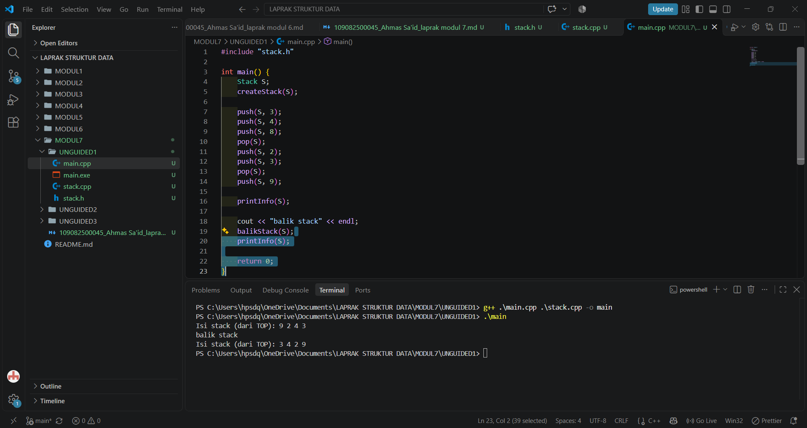
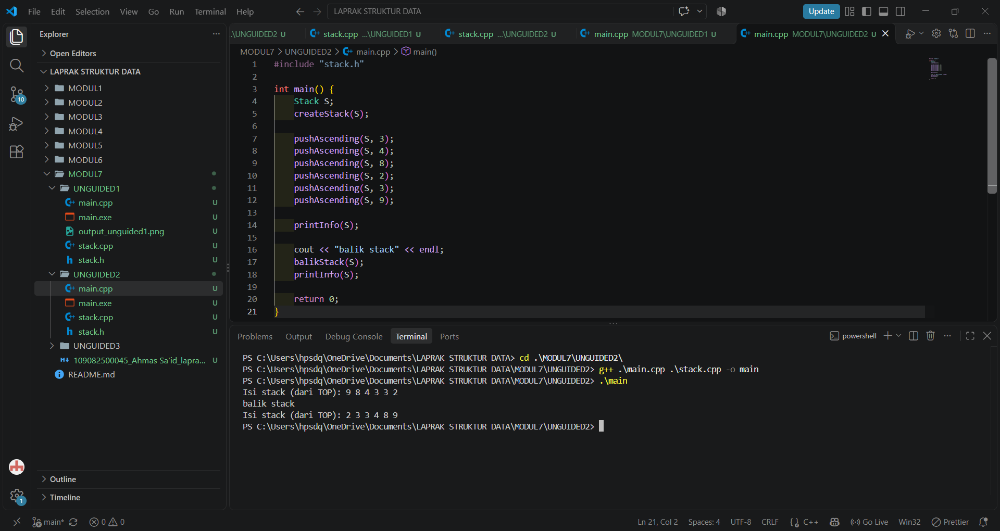
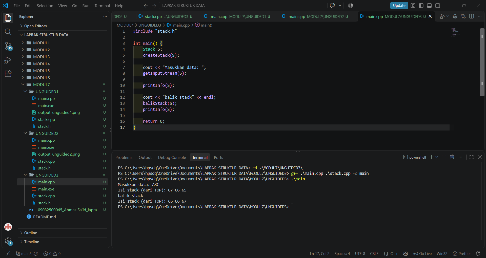

# <h1 align="center">Laporan Praktikum Modul 7 – Stack</h1>
<p align="center">Ahmas Sa'id - 109082500045</p>

## Dasar Teori
Stack adalah struktur data linear yang menggunakan prinsip LIFO (Last In First Out). Elemen yang terakhir dimasukkan akan menjadi elemen pertama yang diambil. Stack hanya dapat diakses melalui satu ujung yang disebut Top.
Operasi utama pada stack:
Push, yaitu menambahkan elemen ke posisi Top.
Pop, yaitu mengambil/menghapus elemen dari posisi Top.
isEmpty, untuk mengecek apakah stack kosong.
createStack, untuk membuat stack kosong.
printInfo/viewStack, untuk menampilkan isi stack.
Stack dapat direpresentasikan dengan dua cara:
Representasi pointer, yaitu menggunakan node dan pointer Top.
Representasi tabel/array, yaitu menggunakan array dan indeks Top.
Pada representasi tabel, biasanya Top = 0 menandakan stack kosong. Saat push, Top bertambah lalu data disimpan pada indeks Top-1. Saat pop, data diambil dari indeks Top-1 lalu Top berkurang.

## Guided 

### 1. Implementasi ADT Stack Representasi Tabel
```C++
/* file : stack.h
   contoh ADT stack dengan representasi tabel */
#ifndef STACK_H_INCLUDED
#define STACK_H_INCLUDED

#include <iostream>
using namespace std;

struct infotype {
    char nim[20];
    char nama[20];
};

struct Stack {
    infotype info[10];
    int Top;
};

/* prototype */
/******** pengecekan apakah Stack kosong *********/
int isEmpty(Stack S);
/* mengembalikan nilai 0 jika stack kosong */

/******** pembuatan Stack ********/
void createStack(Stack &S);
/* I.S. sembarang
   F.S. terbentuk stack dengan Top=0 */

/******** penambahan elemen pada Stack ********/
void push(Stack &S, infotype X);
/* I.S. Stack mungkin kosong
   F.S. menambahkan elemen pada stack dengan nilai X, TOP=TOP+1 */

/******** penghapusan elemen pada Stack ********/
void pop(Stack &S, infotype &X);
/* I.S. stack tidak kosong
   F.S. nilai info pada indeks TOP disimpan pada X, kemudian TOP=TOP-1 */

/******** proses semua elemen Stack *********/
void viewStack(Stack S);
/* I.S. stack mungkin kosong
   F.S. jika stack tidak kosong menampilkan semua info yang ada pada stack
*/

#endif // STACK_H_INCLUDED
File: stack.cpp
#include "stack.h"

int isEmpty(Stack S) {
    /* Top = 0 berarti kosong, sesuai komentar di stack.h dikembalikan 0 */
    if (S.Top == 0) {
        return 0;
    } else {
        return 1;
    }
}

void createStack(Stack &S) {
    S.Top = 0;
}

void push(Stack &S, infotype X) {
    if (S.Top < 10) {
        S.Top = S.Top + 1;
        S.info[S.Top - 1] = X;   /* Top 1..10 dipetakan ke indeks array 0..9 */
    } else {
        cout << "Stack penuh, data tidak bisa ditambahkan" << endl;
    }
}

void pop(Stack &S, infotype &X) {
    if (isEmpty(S) != 0) {
        X = S.info[S.Top - 1];
        S.Top = S.Top - 1;
    } else {
        cout << "Stack kosong, tidak ada data yang bisa diambil" << endl;
    }
}

void viewStack(Stack S) {
    if (isEmpty(S) == 0) {
        cout << "Stack kosong" << endl;
    } else {
        cout << "Isi stack (dari TOP):" << endl;
        for (int i = S.Top; i >= 1; i--) {
            cout << i << ". " << S.info[i - 1].nim << " - "
                 << S.info[i - 1].nama << endl;
        }
    }
}
File: main.cpp
#include <iostream>
#include <cstring>
#include "stack.h"
using namespace std;

int main() {
    Stack S;
    infotype data, hasil;

    createStack(S);
    cout << "Stack baru dibuat, Top = " << S.Top << endl;
    viewStack(S);

    cout << endl << "--- Push 3 data ---" << endl;
    strcpy(data.nim, "103112400001");
    strcpy(data.nama, "Andi");
    push(S, data);

    strcpy(data.nim, "103112400002");
    strcpy(data.nama, "Budi");
    push(S, data);

    strcpy(data.nim, "103112400003");
    strcpy(data.nama, "Citra");
    push(S, data);
    viewStack(S);

    cout << endl << "--- Pop 1 data ---" << endl;
    pop(S, hasil);
    cout << "Data yang diambil: " << hasil.nim << " - " << hasil.nama << endl;
    viewStack(S);

    cout << endl << "--- Pop sampai kosong ---" << endl;
    pop(S, hasil);
    pop(S, hasil);
    pop(S, hasil);
    viewStack(S);

    return 0;
}

Program membuat stack kosong dengan createStack, sehingga Top = 0. Fungsi push menambahkan data ke array lalu menaikkan Top. Fungsi pop mengambil data pada indeks Top-1, menyimpannya ke variabel X, lalu menurunkan Top. Prosedur viewStack menampilkan data dari Top menuju bawah stack. Karena isEmpty pada header mengembalikan 0 saat stack kosong, maka pengecekan “stack tidak kosong” dilakukan dengan isEmpty(S) != 0.

## Unguided 

### 1. ADT Stack Array Integer

```C++
File: stack.h
#ifndef STACK_H_INCLUDED
#define STACK_H_INCLUDED

#include <iostream>
using namespace std;

#define MAX_STACK 20

typedef int infotype;

struct Stack {
    infotype info[MAX_STACK];
    int top;
};

void createStack(Stack &S);
bool isEmpty(Stack S);
bool isFull(Stack S);
void push(Stack &S, infotype x);
infotype pop(Stack &S);
void printInfo(Stack S);
void balikStack(Stack &S);
void pushAscending(Stack &S, infotype x);
void getInputStream(Stack &S);

#endif

File: stack.cpp
#include "stack.h"

void createStack(Stack &S) {
    S.top = 0;
}

bool isEmpty(Stack S) {
    return S.top == 0;
}

bool isFull(Stack S) {
    return S.top >= MAX_STACK;
}

void push(Stack &S, infotype x) {
    if (!isFull(S)) {
        S.info[S.top] = x;
        S.top++;
    } else {
        cout << "Stack penuh, data tidak bisa ditambahkan" << endl;
    }
}

infotype pop(Stack &S) {
    if (!isEmpty(S)) {
        S.top--;
        return S.info[S.top];
    } else {
        cout << "Stack kosong, tidak ada data yang bisa diambil" << endl;
        return -999;
    }
}

void printInfo(Stack S) {
    if (isEmpty(S)) {
        cout << "Stack kosong" << endl;
    } else {
        cout << "Isi stack (dari TOP): ";
        for (int i = S.top - 1; i >= 0; i--) {
            cout << S.info[i] << " ";
        }
        cout << endl;
    }
}

void balikStack(Stack &S) {
    for (int i = 0; i < S.top / 2; i++) {
        int temp = S.info[i];
        S.info[i] = S.info[S.top - 1 - i];
        S.info[S.top - 1 - i] = temp;
    }
}

void pushAscending(Stack &S, infotype x) {
    if (isFull(S)) {
        cout << "Stack penuh, data tidak bisa ditambahkan" << endl;
        return;
    }

    infotype temp[MAX_STACK];
    int n = 0;

    while (!isEmpty(S) && S.info[S.top - 1] > x) {
        temp[n++] = pop(S);
    }

    push(S, x);

    for (int i = n - 1; i >= 0; i--) {
        push(S, temp[i]);
    }
}

void getInputStream(Stack &S) {
    char c;
    while (cin.get(c) && c != '\n') {
        if (!isFull(S)) {
            push(S, (infotype)c);
        } else {
            break;
        }
    }
}

File: main.cpp  
#include "stack.h"

int main() {
    Stack S;
    createStack(S);

    push(S, 3);
    push(S, 4);
    push(S, 8);
    pop(S);
    push(S, 2);
    push(S, 3);
    pop(S);
    push(S, 9);

    printInfo(S);

    cout << "balik stack" << endl;
    balikStack(S);
    printInfo(S);

    return 0;
}
```
### Output Unguided 1 :

##### Output 1


Program ini mengimplementasikan stack menggunakan array berukuran 20 dengan indeks top. Stack kosong ditandai top = 0. Operasi push menambahkan data pada indeks top lalu menaikkan top, sedangkan pop menurunkan top lalu mengambil data. Prosedur balikStack membalik urutan isi array dengan menukar elemen dari depan dan belakang. Pada main, urutan push/pop menghasilkan isi stack dari TOP: 9 2 4 3, lalu setelah dibalik menjadi 3 4 2 9.

### 2. Penambahan pushAscending

```C++
File: stack.h
#ifndef STACK_H_INCLUDED
#define STACK_H_INCLUDED

#include <iostream>
using namespace std;

#define MAX_STACK 20

typedef int infotype;

struct Stack {
    infotype info[MAX_STACK];
    int top;
};

void createStack(Stack &S);
bool isEmpty(Stack S);
bool isFull(Stack S);
void push(Stack &S, infotype x);
infotype pop(Stack &S);
void printInfo(Stack S);
void balikStack(Stack &S);
void pushAscending(Stack &S, infotype x);
void getInputStream(Stack &S);

#endif

File: stack.cpp
#include "stack.h"

void createStack(Stack &S) {
    S.top = 0;
}

bool isEmpty(Stack S) {
    return S.top == 0;
}

bool isFull(Stack S) {
    return S.top >= MAX_STACK;
}

void push(Stack &S, infotype x) {
    if (!isFull(S)) {
        S.info[S.top] = x;
        S.top++;
    } else {
        cout << "Stack penuh, data tidak bisa ditambahkan" << endl;
    }
}

infotype pop(Stack &S) {
    if (!isEmpty(S)) {
        S.top--;
        return S.info[S.top];
    } else {
        cout << "Stack kosong, tidak ada data yang bisa diambil" << endl;
        return -999;
    }
}

void printInfo(Stack S) {
    if (isEmpty(S)) {
        cout << "Stack kosong" << endl;
    } else {
        cout << "Isi stack (dari TOP): ";
        for (int i = S.top - 1; i >= 0; i--) {
            cout << S.info[i] << " ";
        }
        cout << endl;
    }
}

void balikStack(Stack &S) {
    for (int i = 0; i < S.top / 2; i++) {
        int temp = S.info[i];
        S.info[i] = S.info[S.top - 1 - i];
        S.info[S.top - 1 - i] = temp;
    }
}

void pushAscending(Stack &S, infotype x) {
    if (isFull(S)) {
        cout << "Stack penuh, data tidak bisa ditambahkan" << endl;
        return;
    }

    infotype temp[MAX_STACK];
    int n = 0;

    while (!isEmpty(S) && S.info[S.top - 1] > x) {
        temp[n++] = pop(S);
    }

    push(S, x);

    for (int i = n - 1; i >= 0; i--) {
        push(S, temp[i]);
    }
}

void getInputStream(Stack &S) {
    char c;
    while (cin.get(c) && c != '\n') {
        if (!isFull(S)) {
            push(S, (infotype)c);
        } else {
            break;
        }
    }
}
File: main.cpp
#include "stack.h"

int main() {
    Stack S;
    createStack(S);

    pushAscending(S, 3);
    pushAscending(S, 4);
    pushAscending(S, 8);
    pushAscending(S, 2);
    pushAscending(S, 3);
    pushAscending(S, 9);

    printInfo(S);

    cout << "balik stack" << endl;
    balikStack(S);
    printInfo(S);

    return 0;
}
```
### Output Unguided 2 :

##### Output 1


Program ini menambahkan prosedur pushAscending, yaitu push yang menjaga isi stack tetap terurut ascending dari bawah ke atas. Caranya, elemen yang lebih besar dari nilai baru dikeluarkan sementara ke array bantu, nilai baru dimasukkan, lalu elemen bantu dikembalikan. Karena printInfo mencetak dari TOP, hasilnya terlihat descending: 9 8 4 3 3 2. Setelah balikStack, urutannya menjadi ascending: 2 3 3 4 8 9.

### 3. Penambahan getInputStream

```C++
File: stack.h
#ifndef STACK_H_INCLUDED
#define STACK_H_INCLUDED

#include <iostream>
using namespace std;

#define MAX_STACK 20

typedef int infotype;

struct Stack {
    infotype info[MAX_STACK];
    int top;
};

void createStack(Stack &S);
bool isEmpty(Stack S);
bool isFull(Stack S);
void push(Stack &S, infotype x);
infotype pop(Stack &S);
void printInfo(Stack S);
void balikStack(Stack &S);
void pushAscending(Stack &S, infotype x);
void getInputStream(Stack &S);

#endif

File: stack.cpp
#include "stack.h"

void createStack(Stack &S) {
    S.top = 0;
}

bool isEmpty(Stack S) {
    return S.top == 0;
}

bool isFull(Stack S) {
    return S.top >= MAX_STACK;
}

void push(Stack &S, infotype x) {
    if (!isFull(S)) {
        S.info[S.top] = x;
        S.top++;
    } else {
        cout << "Stack penuh, data tidak bisa ditambahkan" << endl;
    }
}

infotype pop(Stack &S) {
    if (!isEmpty(S)) {
        S.top--;
        return S.info[S.top];
    } else {
        cout << "Stack kosong, tidak ada data yang bisa diambil" << endl;
        return -999;
    }
}

void printInfo(Stack S) {
    if (isEmpty(S)) {
        cout << "Stack kosong" << endl;
    } else {
        cout << "Isi stack (dari TOP): ";
        for (int i = S.top - 1; i >= 0; i--) {
            cout << S.info[i] << " ";
        }
        cout << endl;
    }
}

void balikStack(Stack &S) {
    for (int i = 0; i < S.top / 2; i++) {
        int temp = S.info[i];
        S.info[i] = S.info[S.top - 1 - i];
        S.info[S.top - 1 - i] = temp;
    }
}

void pushAscending(Stack &S, infotype x) {
    if (isFull(S)) {
        cout << "Stack penuh, data tidak bisa ditambahkan" << endl;
        return;
    }

    infotype temp[MAX_STACK];
    int n = 0;

    while (!isEmpty(S) && S.info[S.top - 1] > x) {
        temp[n++] = pop(S);
    }

    push(S, x);

    for (int i = n - 1; i >= 0; i--) {
        push(S, temp[i]);
    }
}

void getInputStream(Stack &S) {
    char c;
    while (cin.get(c) && c != '\n') {
        if (!isFull(S)) {
            push(S, (infotype)c);
        } else {
            break;
        }
    }
}
File: main.cpp
#include "stack.h"

int main() {
    Stack S;
    createStack(S);

    cout << "Masukkan data: ";
    getInputStream(S);

    printInfo(S);

    cout << "balik stack" << endl;
    balikStack(S);
    printInfo(S);

    return 0;
}
```
### Output Unguided 3 :

##### Output 1


Program ini menambahkan prosedur getInputStream yang membaca input user karakter demi karakter menggunakan cin.get() sampai user menekan Enter. Setiap karakter langsung dimasukkan ke stack. Pada contoh input ABC, stack menyimpan nilai ASCII 65 66 67, sehingga saat dicetak dari TOP terlihat 67 66 65. Setelah balikStack, urutannya menjadi 65 66 67. Jika ingin menampilkan huruf aslinya, tipe infotype bisa diganti menjadi char.

## Kesimpulan
Dari praktikum Modul 7 ini dapat disimpulkan bahwa stack merupakan struktur data LIFO yang hanya dapat diakses melalui satu ujung, yaitu Top. Implementasi stack dengan representasi tabel menggunakan array dan indeks Top, sedangkan representasi pointer menggunakan node dan pointer Top. Operasi dasar stack meliputi createStack, isEmpty, push, pop, dan printInfo. Pada stack array, Top = 0 menandakan stack kosong, push menaikkan Top sebelum menyimpan data, dan pop menurunkan Top setelah mengambil data. Prosedur tambahan seperti balikStack, pushAscending, dan getInputStream dapat dibuat dengan memanfaatkan operasi dasar stack dan array bantu.

## Referensi
[1] Tim Laboratorium Struktur Data. (2024). Modul 7 STACK.
<br>[2] Triase. (2020). Diktat Edisi Revisi: Struktur Data. Medan: Universitas Islam Negeri Sumatera Utara Medan.
<br>[3] Indahyati, Uce., Rahmawati Yunianita. (2020). Buku Ajar Algoritma dan Pemrograman dalam Bahasa C++. Sidoarjo: Umsida Press.